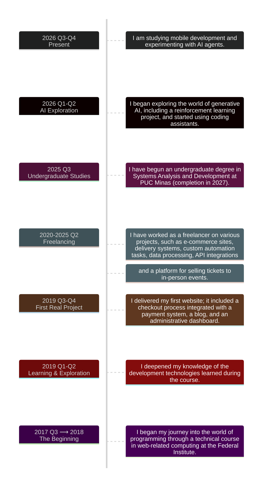

<h3>Hi, I'm Geovani 👋</h3>

<strong>Software Developer | Full-Stack Development</strong>

---

### About Me

- 💻 Experienced in web development.
- ⚙️ Interested in backend systems and automation.
- 🐧 Comfortable exploring Linux environments and command-line tools.
- 🤝 Open to collaboration on interesting projects.

---

### My Journey

- **2026-2020**: Freelancing and personal projects, including e-commerce and delivery systems, platforms for selling tickets to in-person events, custom automation tasks, and data processing.
- **2020**: First real project delivered, including a checkout process integrated with a payment system, a blog, and an administrative dashboard.
- **2017-2019**: Began programming journey through a technical course in web-related computing at a <a href="https://www.ifspcaraguatatuba.edu.br/">Federal Institute</a>.

Detailed journey

---

### Technologies

#### I'm Proficient In

##### Frontend

##### Backend

##### DevOps, Tools & Other Technologies

---

#### I've Explored

---

### Let's Connect

