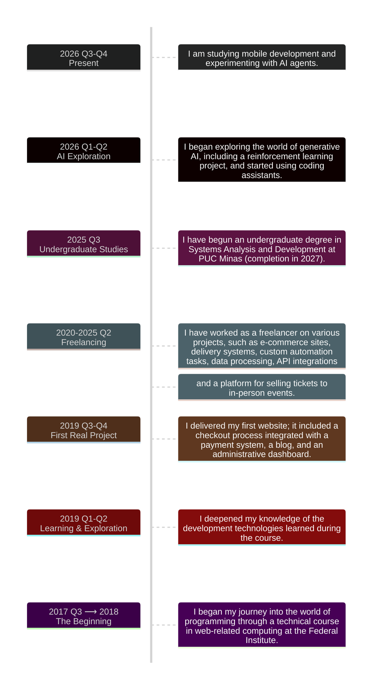

<h3>Hi, I'm Geovani 👋</h3>

<strong>Software Developer | Full-Stack Development</strong>

---

### My Journey

---

### Technologies

#### I'm Proficient In

##### Frontend

##### Backend

##### DevOps, Tools & Other Technologies

---

#### I've Explored

