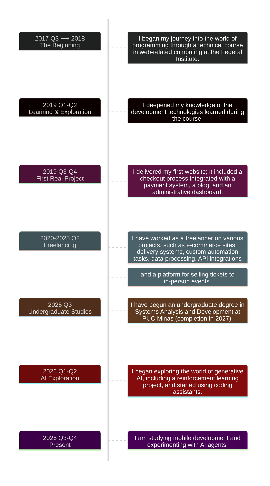

### Hi, I'm Geovani 👋

I am software developer from Brazil .

##### About Me:

- 💻 Experienced in web development.
- ⚙️ Interested in backend systems and automation.
- 🐧 Comfortable exploring Linux environments and command-line tools.
- 🤝 Open to collaboration on interesting projects.

---

#### Projects

###### My repositories

<table border>

<tr>
<td>
<a href="https://github.com/geovani-ra/jackett-client-app">
<small><b>jackett-client-app</b></small>
</a>
</td>
<td>

</td>
</tr>

<tr>
<td>
<a href="https://github.com/geovani-ra/jackett-client-telegram-bot">
<small><b>jackett-client-telegram-bot</b></small>
</a>
</td>
<td>

</td>
</tr>

</table>

###### My stars

<table>

<tr>
<td>

</td>
<td>

</td>
</tr>

<tr>
<tr>
<td>

</td>
<td>

</td>
</tr>

<tr>
<td>
<a href="https://github.com/vueuse/vueuse">
<small><b>vueuse/vueuse</b></small>
</a>
</td>
<td>

</td>
</tr>

<tr>
<td>

</td>
<td>

</td>
</tr>

<tr>
<td>

</td>
<td>

</td>
</tr>

<tr>
<td>

</td>
<td>

</td>
</tr>

<tr>
<td>
<a href="https://github.com/donnemartin/system-design-primer">
<small><b>donnemartin/system-design-primer</b></small>
</a>
</td>
<td>

</td>
</tr>

<tr>
<td>

</td>
<td>

</tr>

</table>

---

### My Journey

- **2017–2018**: Started my programming journey through a technical course in web development.
- **2019**: Delivered my first real-world project, featuring a payment system, blog, and admin dashboard.
- **2020–2025**: Worked as a freelancer on web platforms, automations, API integrations, and data processing solutions.
- **2025–2027**: Pursuing a degree in Systems Analysis and Development at PUC Minas.
- **2026–Present**: Exploring generative AI, reinforcement learning, AI agents, and mobile development.

Detailed journey

 

---

### Technologies

##### I'm Proficient In

###### Frontend

###### Backend

<!--  -->

###### DevOps, Tools & Other Technologies

##### I've Explored

---

### Let's Connect

