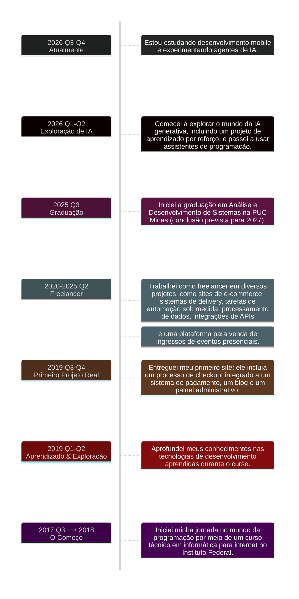

<h3>Olá, sou o Geovani 👋</h3>

<strong>Desenvolvedor de Software | Desenvolvimento Full-Stack</strong>

---

### Sobre Mim

- 💻 Experiência em desenvolvimento web.
- ⚙️ Interesse em sistemas backend e automação.
- 🐧 À vontade explorando ambientes Linux e ferramentas de linha de comando.
- 🤝 Aberto a colaborações em projetos interessantes.

---

### Minha Trajetória

- **2026-2020**: Freelancer e projetos pessoais, incluindo sistemas de e-commerce e delivery, plataformas para venda de ingressos de eventos presenciais, tarefas de automação sob medida e processamento de dados.
- **2020**: Primeiro projeto real entregue, incluindo um processo de checkout integrado a um sistema de pagamento, um blog e um painel administrativo.
- **2017-2019**: Início na programação por meio de um curso técnico em informática para internet em um <a href="https://www.ifspcaraguatatuba.edu.br/">Instituto Federal</a>.

Trajetória detalhada

---

### Tecnologias

#### Tenho Domínio em

##### Frontend

##### Backend

##### DevOps, Ferramentas & Outras Tecnologias

---

#### Já Explorei

---

### Vamos Conversar

