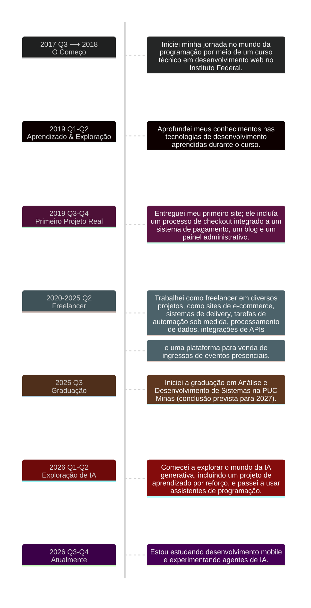

### Olá, sou o Geovani 👋

Sou desenvolvedor de software do Brasil .

---

### Sobre Mim

- 💻 Experiência em desenvolvimento web.
- ⚙️ Interesse em sistemas backend e automação.
- 🐧 À vontade explorando ambientes Linux e ferramentas de linha de comando.
- 🤝 Aberto a colaborações em projetos interessantes.

---

### Projetos

###### Meus repositórios

<table border>

<tr>
<td>
<a href="https://github.com/geovani-ra/jackett-client-app">
<small><b>jackett-client-app</b></small>
</a>
</td>
<td>

</td>
</tr>

<tr>
<td>
<a href="https://github.com/geovani-ra/jackett-client-telegram-bot">
<small><b>jackett-client-telegram-bot</b></small>
</a>
</td>
<td>

</td>
</tr>

<tr>
<td>
<a href="https://github.com/geovani-ra/comfyui-telegram-image-saver">
<small><b>comfyui-telegram-image-saver</b></small>
</a>
</td>
<td>

</td>
</tr>

</table>

###### Minhas estrelas

<table>

<tr>
<td>

</td>
<td>

</td>
</tr>

<tr>
<tr>
<td>

</td>
<td>

</td>
</tr>

<tr>
<td>
<a href="https://github.com/vueuse/vueuse">
<small><b>vueuse/vueuse</b></small>
</a>
</td>
<td>

</td>
</tr>

<tr>
<td>

</td>
<td>

</td>
</tr>

<tr>
<td>

</td>
<td>

</td>
</tr>

<tr>
<td>

</td>
<td>

</td>
</tr>

<tr>
<td>
<a href="https://github.com/donnemartin/system-design-primer">
<small><b>donnemartin/system-design-primer</b></small>
</a>
</td>
<td>

</td>
</tr>

<tr>
<td>

</td>
<td>

</tr>

<tr>
<td>

</td>
<td>

</tr>

</table>

---

### Minha Trajetória

- **2017–2018**: Comecei a programar por meio de um curso técnico em desenvolvimento web no Instituto Federal.
- **2019 (1º semestre)**: Ampliei meus conhecimentos em tecnologias de desenvolvimento web.
- **2019 (2º semestre)**: Entreguei o primeiro projeto real, com sistema de pagamento, blog e painel administrativo.
- **2020–2025**: Freelancer em e-commerce, sistemas de delivery, automação, processamento de dados, integrações de APIs e plataformas de venda de ingressos.
- **2025**: Iniciei a graduação em Análise e Desenvolvimento de Sistemas na PUC Minas (conclusão prevista para 2027).
- **2026 (1º semestre)**: Explorei IA generativa, aprendizado por reforço e assistentes de programação.
- **2026 (2º semestre)**: Estudando desenvolvimento mobile e experimentando agentes de IA.

Trajetória detalhada

---

### Tecnologias que utilizo

Linguagens: 

Frameworks & bibliotecas: 

Infraestrutura: 

Serviços & Ferramentas: 

---
 

Outras Tecnologias com as quais interagi:  

---

### Vamos nos conectar

